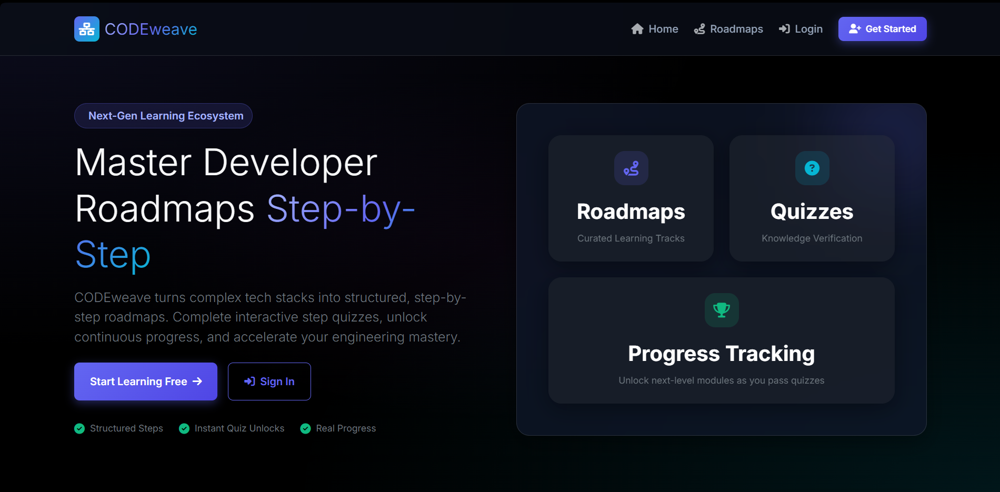
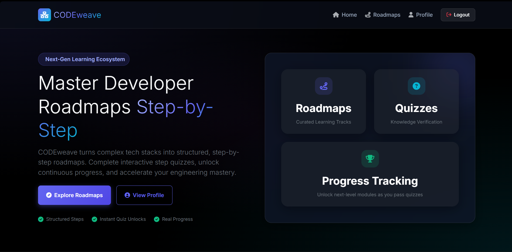
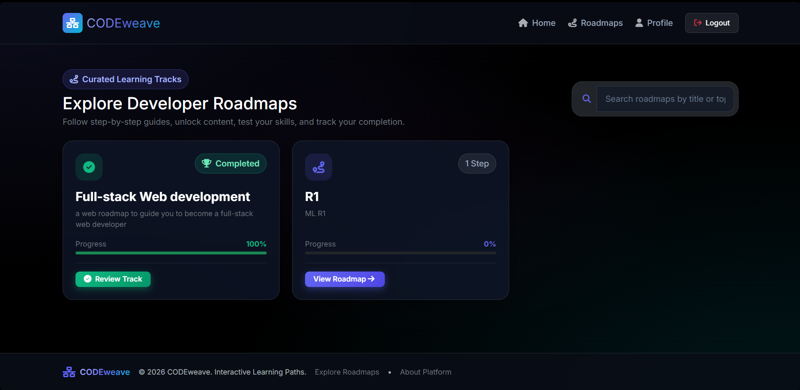
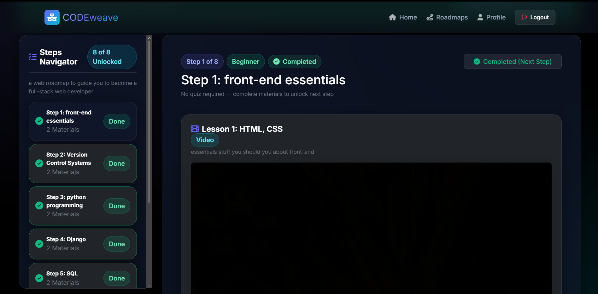
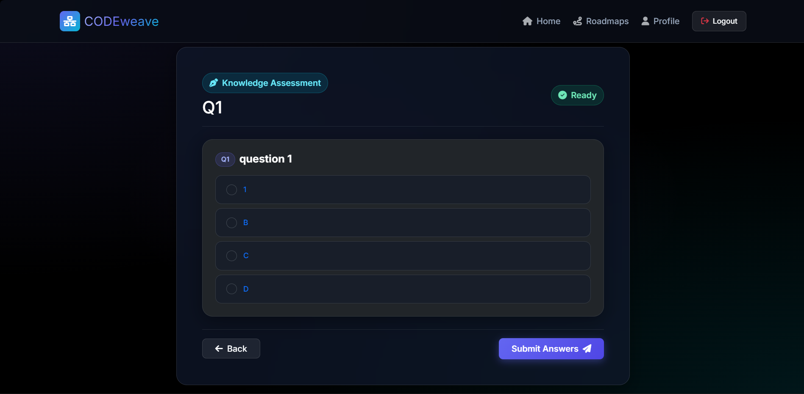
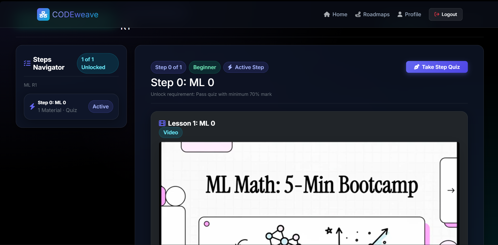

# CodeWeave – Software Development Learning Platform

CodeWeave is a web-based learning platform designed to help aspiring software developers learn through structured roadmaps, interactive assessments, and mastery-based progression.

The platform organizes learning into sequential steps, allowing students to follow a clear learning path, access educational materials, test their understanding, and track their progress.

## Key Features

- **Role-Based Access Control:** Separate roles and permissions for students, instructors, and administrators.
- **Structured Learning Roadmaps:** Organizes learning content into roadmaps with sequential steps.
- **Learning Materials:** Provides educational videos, articles, and code examples.
- **Interactive Quizzes:** Allows students to assess their understanding through quizzes.
- **Mastery-Based Progression:** Students must achieve a score of at least 80% on a step's quiz to unlock the next step.
- **Adaptive Quiz Retakes:** Retake questions focus on the categories the student answered incorrectly in previous attempts.
- **Progress Tracking:** Tracks student learning progress and assessment performance.
- **Instructor Management:** Enables instructors to manage their assigned learning content, roadmap steps, and quizzes.

## Screenshots

### Registration


### Home Page


### Learning Roadmaps


### Lesson Page


### Quiz


### Additional Lesson View


## Technology Stack

| Category | Technologies |
|---|---|
| Backend | Python, Django |
| API | Django REST Framework |
| Frontend | HTML, CSS, JavaScript, Bootstrap |
| Database | SQLite |
| Version Control | Git, GitHub |

## Project Structure

```text
CodeWeave/
├── accounts/
├── config/
├── quizzes/
├── roadmaps/
├── static/
├── templates/
├── screenshots/
├── manage.py
├── requirements.txt
└── .gitignore
```

## Installation and Setup

Follow these steps to run CodeWeave locally.

### 1. Clone the repository

```bash
git clone https://github.com/abuhani26/CodeWeave.git
cd CodeWeave
```

### 2. Create and activate a virtual environment

On Windows:

```bash
python -m venv venv
venv\Scripts\activate
```

### 3. Install dependencies

```bash
pip install -r requirements.txt
```

### 4. Apply database migrations

```bash
python manage.py migrate
```

### 5. Create an administrator account

```bash
python manage.py createsuperuser
```

Follow the prompts to create your administrator credentials.

### 6. Run the development server

```bash
python manage.py runserver
```

Open your browser and visit:

```text
http://127.0.0.1:8000/
```

## Project Status

CodeWeave is an implemented academic capstone project developed as part of my Software Engineering studies.

## Author

**Alaa Abu Hani**

- GitHub: [@abuhani26](https://github.com/abuhani26)
- LinkedIn: [Alaa Abu Hani](https://www.linkedin.com/in/alaa-abu-hani-0a9653285/)
